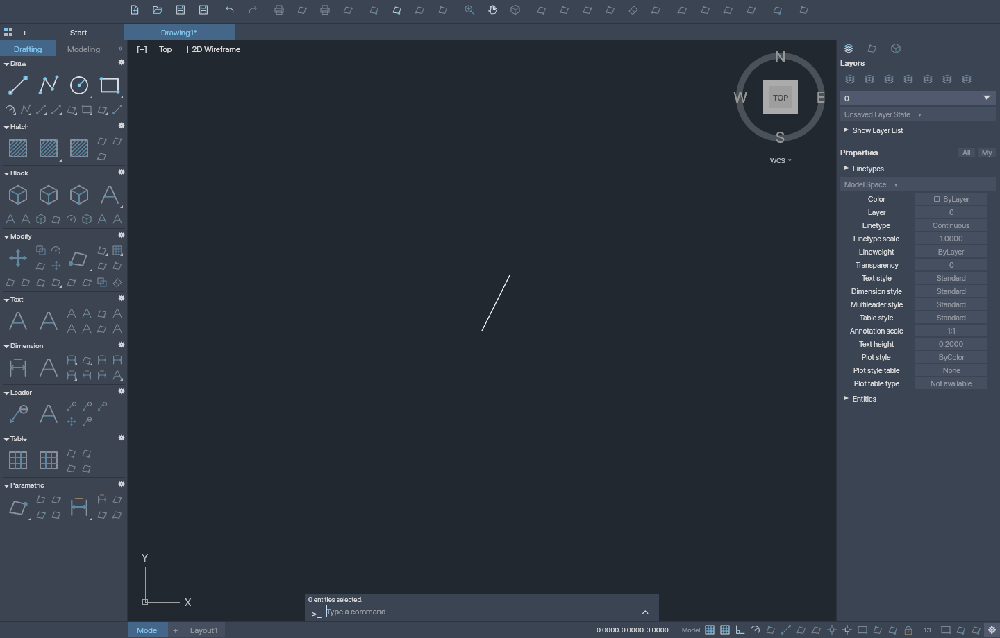
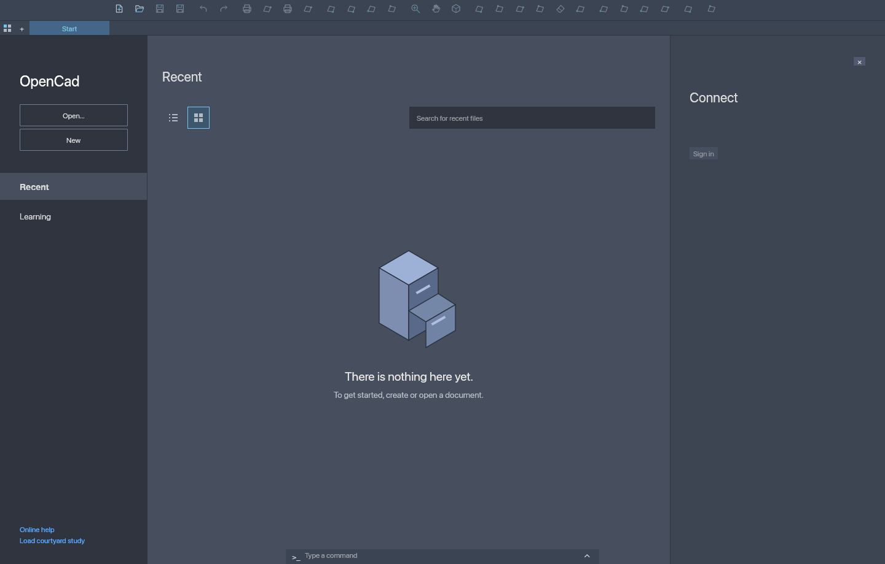

# OpenCad

[](https://github.com/nanashili/OpenCad/actions/workflows/build.yml)
[](LICENSE)

**An AutoCAD reverse engineering project with an independent clean-room implementation in Rust.**

OpenCad recreates the familiar desktop drafting layout and implements a growing
subset of CAD editing and R12 ASCII DXF exchange. It is an early project: full
AutoCAD feature parity and DWG support are not implemented.

Reverse engineering documents AutoCAD's UI, behavior and file interchange.
The code and icon artwork are original OpenCad work. Functional UI names and
organization were documented from AutoCAD for Mac. The [clean-room process](docs/CLEAN_ROOM.md)
explains how reference investigators document behavior contracts for a separate
implementation lane that writes original code.
OpenCad is not affiliated with or endorsed by Autodesk.

## Screenshots

### Drafting workspace



### Start page



These captures show OpenCad's actual rendered widgets using original artwork and
synthetic drawing data. They are generated by the desktop UI tests; native title
bars and macOS menu chrome are outside the captures. [Reproduce them](docs/DEVELOPMENT.md#screenshots).

## Current capabilities

- Draw lines, circles, arcs, rectangles and 2D polylines with straight or bulged segments.
- Select, move, copy, erase, undo/redo and inspect supported geometry.
- Edit layers, visibility, locks, indexed colors, simple linetypes and entity style overrides.
- Use grid, object snap, grid snap, ortho and polar tracking in an XY top view.
- Open and save supported R12 ASCII DXF documents, preserving untouched source records.
- Export the XY drawing to SVG and use the geometry/DXF command line tools.
- Customize toolsets and status items, retain workspace preferences and recent files across restarts, switch between Start and a drawing, and use native macOS menus.

The interface includes commands that are not implemented yet; they remain
disabled. Validated header, table and block metadata can be retained without
being rendered or editable; unsupported top-level entities are rejected. Arbitrary planes, 3D polylines, polyline widths, complex linetypes,
dimensions, solids and broad block workflows remain unfinished. See [usage and format limits](docs/USAGE.md).

## Downloads and releases

Download packages from [GitHub Releases](https://github.com/nanashili/OpenCad/releases).
Every version tag builds these artifacts:

| Platform | Architecture | Artifact |
| --- | --- | --- |
| macOS | Apple Silicon / arm64 | `OpenCad-<version>-macos-arm64.zip` |
| macOS | Intel / x64 | `OpenCad-<version>-macos-x64.zip` |
| Windows | x64 | `OpenCad-<version>-windows-x64.zip` |
| Linux | x64 | `OpenCad-<version>-linux-x64.tar.gz` |

Each package includes the desktop app, CLI, examples, documentation, MIT license
and dependency notices. `SHA256SUMS.txt` contains checksums for all four archives.
Branch builds also retain downloadable artifacts in [GitHub Actions](https://github.com/nanashili/OpenCad/actions).

- **macOS 13 or later:** extract the ZIP and move `OpenCad.app` to Applications. Bundles are ad hoc signed, not notarized; macOS may require approval in Privacy & Security when first opened.
- **Windows:** extract the ZIP and run `opencad-ui.exe`. Binaries are unsigned; Windows may show a publisher warning.
- **Linux:** extract the tarball and run `./opencad-ui`. Requires an X11 or Wayland desktop with OpenGL and Ubuntu 22.04 compatible system libraries; this is a dynamically linked portable archive.

GUI behavior is covered by headless widget tests. Build and CLI checks run on each
release platform; this does not replace manual native window testing.

## Development

Install [Rust](https://www.rust-lang.org/tools/install), Git and Python 3. The
repository pins Rust 1.93.1 and commits its dependency lockfile. Platform build
dependencies and contribution guidance are in [DEVELOPMENT.md](docs/DEVELOPMENT.md).

```sh
git clone https://github.com/nanashili/OpenCad.git
cd OpenCad
cargo run --locked --features desktop --bin opencad-ui -- examples/courtyard.dxf
```

Run the checks:

```sh
cargo fmt --check
cargo clippy --locked --all-features --all-targets -- -D warnings
cargo test --locked --all-features
```

The geometry library and CLI build without desktop dependencies:

```sh
cargo run --locked -- --help
cargo run --locked -- dxf-copy examples/courtyard.dxf courtyard-copy.dxf
```

On macOS, `./scripts/build-app.sh` creates `dist/OpenCad.app`. See the
[release procedure](docs/DEVELOPMENT.md#releases) to build platform archives or
publish a version tag. No AutoCAD installation is required to build or run OpenCad.

## License and attribution

[MIT](LICENSE). Dependencies retain their own licenses; see [third party notices](THIRD_PARTY_NOTICES.md).
AutoCAD and Autodesk are trademarks of Autodesk, Inc.
